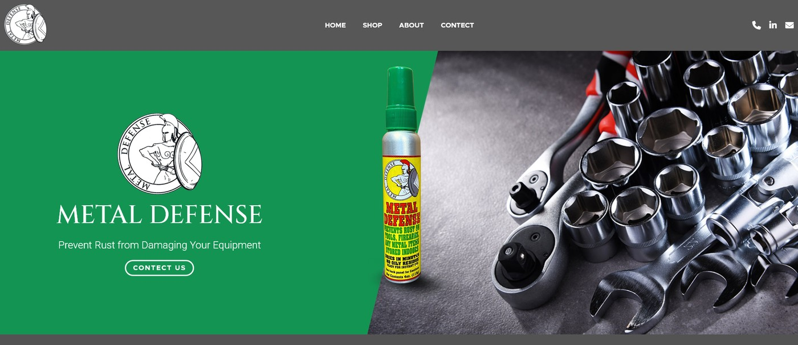
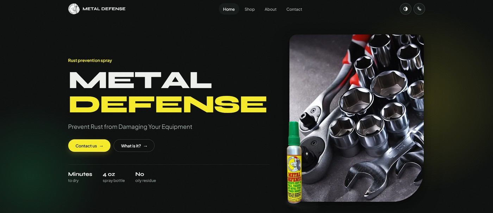
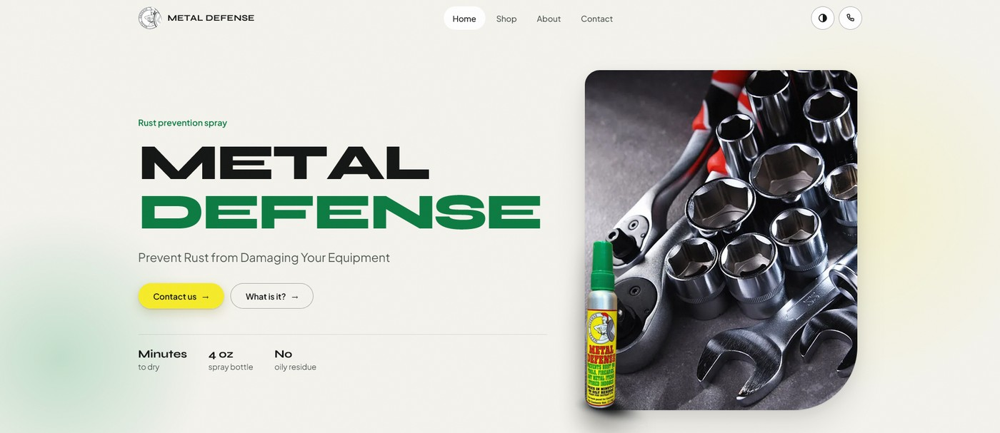

# Metal Defense

A four-page website for a rust prevention spray, written in plain HTML, CSS and JavaScript. No framework, no libraries, no build step, no external requests.

- **Live site (v3):** https://met-al-defence-rebuild.netlify.app/
- **My first version:** https://mental-defend-flex.netlify.app/ (same design as my mentor's page)
- **Where it started:** https://cozy-choux-253b3a.netlify.app/ (my mentor's single-page version, which I followed while learning HTML and CSS)

I took that page as a starting point and rebuilt it three times. This README shows what changed and how it works, so you can compare the sites side by side.

## Before and after

| Mentor's page | This version (v3) |
|---|---|
|  |  |

### Dark and light themes

| Dark (default) | Light |
|---|---|
|  |  |

## At a glance

| | |
|---|---|
| Pages | 4 (Home, Shop, About, Contact) |
| Dependencies | 0 |
| External requests | 0 (fonts, icons and images are all local) |
| CSS | 379 lines, one file |
| JavaScript | 202 lines, one file |
| Images | about 570 KB for the whole `img/` folder (WebP photos) |
| Fonts | 2 self-hosted variable fonts, about 69 KB together |
| Themes | Dark and light |
| Breakpoints | 1100, 900, 720, 480 and 360 px, plus a print stylesheet |

## Mentor's version vs this version

| | Mentor's page | This version |
|---|---|---|
| Pages | One page. Shop, About and Contact links point to `#` | Four real pages with working navigation |
| Contact | No form on the page | Working contact form with validation, spam trap and a thank-you message |
| Page title | Just "Metal" | Unique title and description per page, Open Graph tags, favicon, theme color |
| About section | First paragraph is repeated twice in a row | Fixed |
| Typos | "CONTECT" in the nav and on the hero button | Fixed |
| Images | PNG and JPG | WebP, with width and height set so the page does not jump while loading |

## What I built

### Design system
- Design tokens in CSS custom properties: colors, radii, spacing and a fluid type scale (`--step-0` to `--step-4`) built with `clamp()`, so text and spacing scale smoothly instead of jumping at breakpoints.
- Type pairing: **Syne** for headings, **Plus Jakarta Sans** for body text. Both are self-hosted as variable `woff2` files, so there is no Google Fonts request and the site works offline.
- The hero headline is sized with a **container query** (`cqw` units). "DEFENSE" is a wide word in Syne 800 and used to break mid-word on narrow screens. It now always fits.
- A bento grid for the use cases (tools, fishing, auto parts, snowblowers): 3 columns on desktop, 2 on tablet, 1 on phone. Descriptions are always visible.

### Dark and light themes
- Dark by default, light through the toggle in the header. The choice is saved in `localStorage`.
- Until the visitor picks one, the site follows their operating system setting, including live changes.
- A tiny inline script in `<head>` sets the theme before the first paint, so there is no flash of the wrong theme.
- Switching themes plays a circular reveal from the button, using the View Transitions API. Browsers without support just swap instantly.

### Responsive layout
- Real tablet layouts at 900 px and 720 px. The hero, bento grid, feature cards and footer do not jump from desktop straight to phone.
- Extra rules for 480 px and 360 px screens.
- Print stylesheet.

### Motion and interaction
All of it is vanilla JavaScript or plain CSS.
- Letter-by-letter headline animation (screen readers still get the full headline through `aria-label`).
- Scroll reveal with stagger, using `IntersectionObserver`.
- Scroll progress bar, header that hides on scroll down and returns on scroll up, back-to-top button.
- Seamless marquee loop.
- Page-to-page fade using cross-document view transitions (`@view-transition`), with no JavaScript.
- Mouse devices only: cursor ring, 3D tilt on image cards, cursor spotlight, magnetic buttons, hero parallax. The cursor ring loop goes to sleep when the pointer is still, and tilt is limited to image blocks so text never rotates.
- Everything switches off under `prefers-reduced-motion`.

### Accessibility
- Semantic markup: `header`, `nav`, `main`, `section`, `article`, `figure`, `footer`.
- Skip-to-content link, visible `:focus-visible` outlines, `aria-current` on the active page.
- Alt text on every meaningful image, empty alt on decorative ones.
- Hidden headings (`.sr-only`) so screen readers get a proper outline for sections that have no visible title.
- Menu button updates `aria-expanded` and `aria-label`, and focus returns to it when the menu closes with Escape.
- Form fields have labels, `autocomplete` values, and a visible invalid state.

### Performance
- Photos converted to WebP (about 1.3 MB down to 0.46 MB).
- Hero image uses `fetchpriority="high"`. Images below the fold use `loading="lazy"`.
- Fonts are preloaded.
- `width` and `height` on every image, which avoids layout shift.
- Zero third-party requests, no framework to download or parse.

### Contact form
- Markup uses **Netlify Forms** (`data-netlify="true"`) with a honeypot field for spam.
- After submit, the page returns to `contact.html?sent` and shows a thank-you note.
- The submit button disables itself while sending and resets if the visitor comes back with the browser's back button.
- It is front-end only. Locally the POST goes nowhere. On another host, swap `action` for Formspree or your own endpoint.

### Fixes along the way
- Typo "CONTECT" corrected.
- Broken `tell:` link changed to `tel:`.
- Duplicated paragraph removed from the About section.
- Removed the 01/02/03 numbers on About since it is not a sequence. Shop keeps them because those are real steps.

## Project structure

```
index.html, shop.html, about.html, contact.html
css/style.css    fonts, design tokens, layout, dark and light themes, breakpoints, print
js/main.js       theme toggle, mobile menu, scroll effects, reveal, pointer effects, form state
fonts/           Syne and Plus Jakarta Sans (variable woff2, OFL licenses included)
img/             WebP photos and product shots, PNG icons, favicons
```

## Run it

Open `index.html` in a browser, or serve the folder:

```
npx serve .
```

## Version history

- **v1:** Followed my mentor's page, built with Bootstrap and Font Awesome.
- **v2:** Rewrote it in plain HTML, CSS and JS. Dropped Bootstrap and Font Awesome, added the new type pairing, bento grid and dark/light themes. Built the Shop, About and Contact pages.
- **v3:** Polish pass. Container-query hero, real tablet layouts, better mobile menu, WebP images, favicon and Open Graph tags, form states, accessibility fixes.

## What this project taught me

- CSS custom properties, `clamp()` and fluid type, `color-mix()`, container queries
- Designing dark and light themes from one set of tokens
- The View Transitions API, both for theme switching and page navigation
- `IntersectionObserver`, `requestAnimationFrame` throttling, pointer events
- Keyboard and screen reader support, and `prefers-reduced-motion`
- Image and font loading: WebP, lazy loading, preload, `fetchpriority`
- Netlify Forms and spam protection with a honeypot

## Credits

The idea, page structure and copy come from my mentor's practice page linked at the top. The markup, CSS and JavaScript in this repo are my own rewrite. Brand name, copy and product images belong to Metal Defense. This is a portfolio exercise, not the official site.

Built by [Muhammad Aqib](https://github.com/aqibarbi).